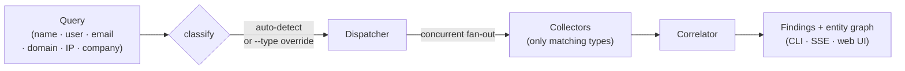

<div align="center">

# 🏮 Lantern

### Modular OSINT aggregation — one query, every source, at once.

Give Lantern a **name, username, email, domain, IP, or company**. It classifies
the input, fans the query out to every relevant data source concurrently, and
streams back what each one found — with a confidence score and a link home.


</div>

---

> **Public data only.** Lantern reads keyless or free-tier APIs plus Tier-1
> clearnet darknet intelligence (no live Tor). It never bypasses
> authentication, scrapes private data, or touches anything behind a login.
> It's SSRF-guarded, rate-limited, and cache-backed by design. **Respect each
> source's Terms of Service, and know your jurisdiction's law before pointing
> it at a person or organization.**

## ✨ Highlights

- **🔀 One input, every applicable source.** Auto-classifies the query and runs
  all matching modules concurrently — results stream in as each responds.
- **🧩 19 collectors, zero stubs.** If a module is registered, it works
  end-to-end against the real API. Most are keyless; the rest degrade
  gracefully when their (free) key isn't set.
- **🪪 Full-name → username pivot.** A legal name like `John Doe` is expanded
  into likely handles (`johndoe`, `john.doe`, `jdoe`, …) and matched across
  site-checks, GitHub, and Keybase — not just the company/person sources.
- **🎯 Optional type override.** Know what you're searching? Force it
  (`--type ip`, or the web dropdown) to skip the ambiguous fan-out — a
  precision and quota win.
- **🕸️ Correlator.** Groups findings into entities, requiring a corroborating
  pivot (shared field or identical URL) before merging same-named-but-different
  things.
- **🟢 Green-Lantern-themed web UI.** Streaming results grouped by source, a
  per-source status row, relationship graph, and a one-click **Copy JSON**.

## 🗺️ How it works



## 🔭 Collectors

| Entity | Sources | Key? |
|---|---|---|
| **Username / Person** | `whatsmyname` (~600 sites) · `github_users` · `keybase` — all three also accept a full **person name** | keyless |
| **Email** | `gravatar` (→ display name + linked socials) · `xposedornot` (breaches) · HIBP Pwned Passwords *(standalone)* | keyless |
| **Domain** | `rdap` (registration) · `crtsh` (cert-transparency subdomains) · `dns-doh` (live A/AAAA/MX/NS/TXT) · `wayback` (first/last archive capture) | keyless |
| **IP / Infra** | `shodan-internetdb` (+ CVEDB) · `ripestat` (prefix/ASN/owner) · `virustotal` · `abuseipdb` | keyless · keyless · free key · free key |
| **Company** | `sec-edgar` · `gleif` (LEI + parent relationships) | keyless |
| **Darknet** *(Tier-1, clearnet)* | `ransomware-live` (victims/groups) · `hudson-rock` (infostealer exposure) | keyless |
| **Search** *(PERSON/DOMAIN)* | `wikipedia` (never needs a key) · `searchapi` (Google results) | keyless · free key |

<sub>Full build log, design rationale, and the sources evaluated-and-dropped (Brave, DuckDuckGo, BGPView, GitLab, Ahmia, Censys) live in **[docs/ARCHITECTURE.md](docs/ARCHITECTURE.md)**.</sub>

## 🚀 Quick start

```bash
# 1. Install (Python 3.11+)
python3 -m venv .venv
.venv/bin/pip install -e ".[dev]"

# 2. Configure
cp .env.example .env         # set CONTACT_EMAIL (required) + API_BEARER_TOKEN

# 3. Search
.venv/bin/lantern search "torvalds"
```

### CLI

```bash
lantern search "example.com"              # auto-detected as a domain
lantern search "John Doe" --type person   # force the type, skip the rest
lantern search "8.8.8.8" --source virustotal   # restrict collectors (repeatable)

# Standalone utilities (not part of the entity pipeline)
lantern check-password "some password"    # HIBP k-anonymity — only a hash prefix leaves your machine
lantern darknet recent --limit 20         # latest disclosed ransomware victims
lantern darknet groups                    # known ransomware groups
```

A query is classified automatically (email / IP / domain, or — if ambiguous —
username, person *and* company together), then every module supporting that
type runs concurrently. `--type` forces a single type; `--source` restricts to
named collectors.

### API

```bash
.venv/bin/python -m lantern.api.app        # binds 127.0.0.1:8000

curl "http://127.0.0.1:8000/search?q=8.8.8.8" \
  -H "Authorization: Bearer $API_BEARER_TOKEN"
```

Streams Server-Sent Events — a `finding` event per result, then a final `done`
event carrying the correlated entity graph (`{"nodes": [...], "edges": [...]}`).
Every route requires the bearer token, even locally; there's no interactive
`/docs` page by design. Add `&type=…` or `&sources=…` to scope a search.

### Web UI

```bash
cd web && npm install && npm run dev       # http://localhost:5173 (API must be running)
```

Open **Settings** → set the API URL + the same bearer token (stored only in
that browser's `localStorage`). From there you can also pick an **input type**,
and toggle any collector on/off under **Modules**.

## 🔑 Configuration

| Variable | Required? | Purpose |
|---|---|---|
| `CONTACT_EMAIL` | **Yes** | Sent in the User-Agent on every request — several sources (e.g. SEC EDGAR) `403` without a real one. |
| `API_BEARER_TOKEN` | **For the API** | Authenticates every API request, even local ones. The CLI never reads it. |
| `VIRUSTOTAL_API_KEY` | Optional | Enables `virustotal`. Free community key, no card — [join](https://www.virustotal.com/gui/join-us). |
| `ABUSEIPDB_API_KEY` | Optional | Enables `abuseipdb`. Free tier 1,000 checks/day — [abuseipdb.com](https://www.abuseipdb.com/). |
| `SEARCHAPI_API_KEY` | Optional | Enables `searchapi`. Free tier **100 searches total, one-time — does not reset** — [searchapi.io](https://www.searchapi.io/). |
| `HUDSONROCK_API_KEY` | Optional | Unused — Hudson Rock uses keyless community endpoints. Kept in case that changes. |
| `CACHE_PATH` | Optional | SQLite TTL cache file (default `lantern_cache.db`). |

Every other collector — including `gravatar`, `dns-doh`, `wayback`, `ripestat`,
`github_users`, `keybase`, and `wikipedia` — is **keyless** and always active.

## 🧪 Tests

```bash
.venv/bin/pytest tests/ -v          # 184 tests, no network — all HTTP is mocked (respx)
cd web && npm run build && npm run lint   # type-check + production build + lint
```

Every collector is tested against mocked HTTP; the SSRF guard and correlator
are each tested exhaustively on their own. No frontend test suite yet (verified
by driving the real stack end to end).

---

<div align="center">
<sub>A coursework OSINT project — built public-only, keyless-first, and ToS-respecting.</sub>
</div>
